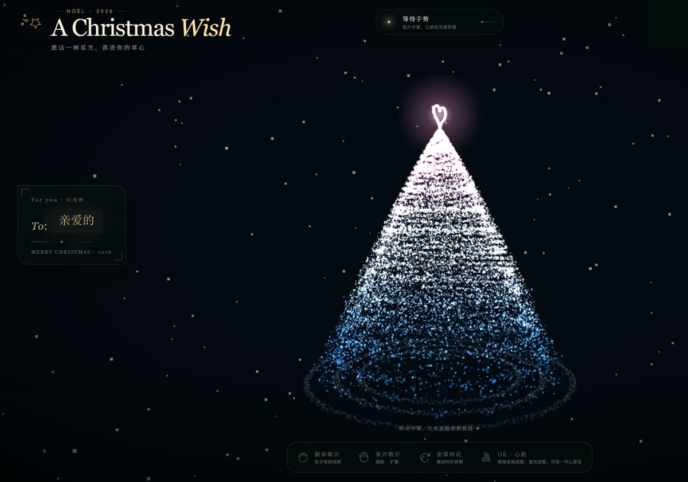

<div align="center">

# 🎄 A Christmas Wish · 手势交互粒子圣诞树

**用 Three.js 与摄像头手势，把散落的光聚成一棵会呼吸的圣诞树。**

[](./LICENSE)
[](https://threejs.org/)
[](https://ai.google.dev/edge/mediapipe/solutions/vision)
[](#快速开始)



*双手张合，星光聚散；一张照片，一段回忆。摄像头画面全程只在本机处理，不上传、不存储。*

</div>

---

## ✨ 这棵树能做什么

- 🌲 **28000 粒子的发光圣诞树**：GPU 着色器实时插值，螺旋光带 + 环形光晕 + 树顶心形灯，聚合与四散都极致丝滑。
- 🖐️ **摄像头手势操控**（基于 MediaPipe 手部关键点）：
  - **握拳** → 粒子聚拢成树
  - **张开手掌** → 散开、缩放、让树在光里舒展
  - **旋掌** → 顺 / 逆时针转动圣诞树
  - **OK 手势** → 星光四散，浮现一句随机的心里话
- 🖼️ **把照片挂上树**：把图片放进 `photos/` 文件夹，本地 `npm start` 会自动扫描；部署前运行 `npm run photos` 生成 `photos.json`。也可以在「回忆」面板里上传 / 拖拽 / 粘贴链接（仅本次浏览有效）。点击照片可放大观赏（3 秒自动收起）。
- 💌 **可编辑题字**：左侧「To: \__\_」支持中文、字数不限，长文本自动缩放折行，绝不遮挡树身。
- 🧠 **手势训练师**：识别不准？现场教它。实时看到识别结果，认错了按数字键即刻纠正并存入记忆库，支持导入 / 导出训练数据。
- 🎬 **净屏观赏模式**：一键隐藏所有提示与控件，只留下树、照片与心愿文案。
- 🔒 **隐私优先 + 完全离线**：Three.js 与 MediaPipe 依赖全部本地化在 `vendor/`，无需联网、无需 CDN，摄像头数据不出本机。

---

## 🚀 快速开始

### 环境要求

- **Node.js 16+**（仅用来启动一个本地静态服务器，无需安装任何 npm 包）
- 支持 **WebGL** 的现代浏览器（Chrome / Edge 推荐）
- 一个摄像头（想无摄像头预览也可以，选「无摄像头漫游」）

> ⚠️ 必须通过本地服务器访问，**不要直接双击 `index.html`** 打开——ES Module 和摄像头权限都需要 `http://` 环境。

### 启动方式（三选一）

**方式 A · Windows 一键启动（最省事）**

双击项目根目录的 `start.bat`，浏览器访问 <http://127.0.0.1:5173>。

**方式 B · 命令行启动（全平台通用）**

```bash
cd 项目目录
node server.js
# 或： npm start
```

然后浏览器打开 <http://127.0.0.1:5173>。

**方式 C · 任意静态服务器**

```bash
npx serve .        # 或 python -m http.server 5173
```

> 第一次点击「开启摄像头」时，浏览器会弹出授权请求，点「允许」即可。手势模型（`hand_landmarker.task`，约 7.5 MB）在本地加载，首次可能需要几秒。

---

## 🎮 操作说明

### 基本手势

| 手势     | 动作            | 效果               |
| ------ | ------------- | ---------------- |
| ✊ 握拳   | 五指收拢          | 粒子聚合成树           |
| 🖐️ 张开 | 五指张开          | 散开 / 缩放，手掌越大树越舒展 |
| 🔄 旋掌  | 转动手掌          | 顺 / 逆时针旋转树       |
| 👌 OK  | 拇指食指成圈，其余三指伸直 | 星光四散，浮现心愿文案      |

### 界面按钮（右上角）

- **全屏**：进入 / 退出全屏观赏。
- **回忆**：打开相册，翻看已经挂上树的照片（照片来自 `photos/` 文件夹）。
- **摄像头**：展开 / 收起摄像头小窗（含手部骨架追踪可视化）。
- **训练师**：打开手势训练面板（详见下一节）。
- **净屏观赏**：隐藏全部提示与控件，只保留树与内容；点右上「退出观赏」返回。

> 💡 **第一次打开**：进入后右下角会出现一张新手引导卡，几秒看懂四个手势，并告诉你「净屏观赏」在哪；看完点 × 关闭即可，之后不会再出现。

### 快捷键

| 按键               | 功能                        |
| ---------------- | ------------------------- |
| `D`              | 开关调试面板（查看各手指伸展度、角度、置信度）   |
| `V`              | 开关全屏手势追踪可视化               |
| `R`              | 重置手势识别（切换手势卡顿 / 识别残留时按一下） |
| `P`              | 切换净屏观赏模式                  |
| `Esc`            | 退出净屏观赏 / 关闭弹窗             |
| `Ctrl/⌘ + Enter` | 在题字编辑框内保存题字               |

---

## 🧠 手势训练师：让识别听你的

规则识别对不对手型？你可以**用自己的手把树"教"会**。完全零依赖（不引入 TensorFlow.js），训练数据只存在你自己的浏览器里。

### 三步上手

1. 点右上角 **「训练师」** 打开面板，摄像头对着自己，摆出一个手势。
2. 看面板顶部的 **实时识别结果**（类别 + 置信度 + 6 类概率条），确认它认得对不对。
3. 如果认错了：保持这个手势，按对应的**数字键**把它存进记忆库，立刻生效。

### 数字键对应类别

| 键   | 类别     | 键   | 类别 |
| --- | ------ | --- | -- |
| `1` | 无 / 其他 | `4` | 捏合 |
| `2` | 握拳     | `5` | 食指 |
| `3` | 张开     | `6` | OK |

### 进阶功能

- **连续采集**：选好类别后按住，可批量录入同一手势；每个类别建议 **15–20 条、多角度** 样本才稳定。
- **ML 接管**：开启后由训练出的模型直接驱动圣诞树（旋转 / 缩放仍走规则层），这是"教会它"效果真正生效的开关。
- **导入 / 导出**：训练数据可导出为 JSON 备份，换设备导入即用。
- **重置识别**：面板内一键清空临时识别状态（等同 `R` 键）。
- **纯预览 / 净屏**：训练时想安静看效果，用净屏观赏模式收起面板，识别照常工作。

> 💡 **小技巧**：识别突然"卡住"或切换不跟手，多半是过渡帧置信度低谷，按 `R` 重置即可，无需把手移出画面。

---

## 📁 目录结构

```
.
├── index.html            页面结构与 UI
├── styles.css            全部样式与视觉动效
├── main.js               Three.js 场景 / 粒子着色器 / 照片对象
├── app.js                MediaPipe 手势识别 / 交互主逻辑 / 主循环
├── gesture-learn.js      手势训练引擎（k-NN + 轻量神经网络）
├── store.js              状态总线与事件总线
├── server.js             零依赖静态服务器（含 /api/photos 扫描）
├── hand_landmarker.task  MediaPipe 手部关键点模型
├── start.bat             Windows 一键启动脚本
├── vendor/               本地化依赖（Three.js + MediaPipe WASM）
│   ├── three/
│   └── mediapipe/
├── LICENSE               MIT 许可证
├── NOTICE.md             第三方依赖归属声明
├── README.md             本文档
└── HOW-TO-PUBLISH.md     GitHub 开源上手指南
```

---

## 🛠️ 技术实现

| 模块    | 技术                                                              |
| ----- | --------------------------------------------------------------- |
| 3D 渲染 | Three.js r160，单个 `THREE.Points` + 自定义 `ShaderMaterial`，28000 粒子 |
| 性能优化  | 位置插值全部放进 GPU 着色器，CPU 每帧只更新 `uSpread` / `uTime` 等少量 uniform      |
| 手势识别  | MediaPipe HandLandmarker（本地 WASM），21 点手部关键点，几何判据 + 迟滞防抖         |
| 手势学习  | 52 维旋转 / 尺度 / 平移不变特征 + 距离加权 k-NN，可选浏览器内 SGD 训练的轻量 MLP           |
| 状态管理  | `store.js` 单一状态源 + 事件总线，解耦识别 / UI / 3D 场景                       |
| 服务端   | 原生 Node.js `http` 模块，零第三方依赖，含路径穿越防护                             |

---

## ❓ 常见问题

**Q：点「开启摄像头」没反应？**  
A：确认是通过 `http://127.0.0.1:5173` 访问（不是双击 html）；首次要等手势模型加载几秒；浏览器地址栏摄像头图标需设为「允许」。

**Q：手势识别不准 / 切换卡顿？**  
A：按 `R` 重置；按 `D` 看调试数值，用「训练师」现场采集校正；每类多采集几个角度的样本。

**Q：我想离线使用可以吗？**  
A：可以。所有依赖都在 `vendor/`，模型在本地，启动后完全不联网。

**Q：照片放哪？**  
A：把图片放进 `photos/` 文件夹。本地 `npm start` 会自动扫描；部署到 GitHub Pages 前运行 `npm run photos` 生成 `photos.json`，刷新页面就会自动挂上树。注意：`photos/` 里的照片会随仓库一起公开，私人照片不要放进去；临时挂几张可以用「回忆」面板上传，刷新后会消失。

**Q：能在手机 / 其他系统跑吗？**  
A：代码本身跨平台，需通过本地 HTTP 服务器访问；摄像头在部分移动浏览器上权限行为不同，桌面 Chrome / Edge 体验最佳。

---

## 🤝 贡献

欢迎 Issue 与 Pull Request！提交前请先：

1. 说明改动动机与效果；
2. 涉及手势逻辑的改动，附上识别前后的实测描述；
3. 保持零运行依赖、离线可用的特性。

---

## 📄 许可

本项目代码采用 [MIT License](./LICENSE) 开源。第三方依赖（Three.js、MediaPipe 等）的许可与归属见 [NOTICE.md](./NOTICE.md)。

---

<div align="center">

*Made with ❤️ for someone special.*

</div>
