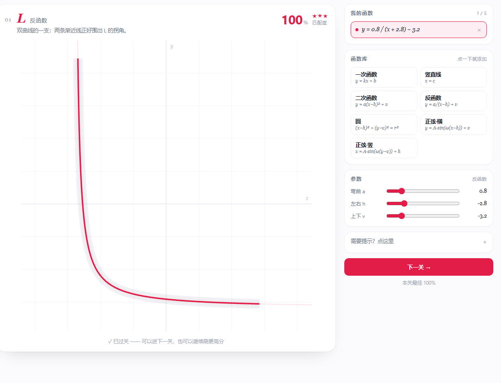
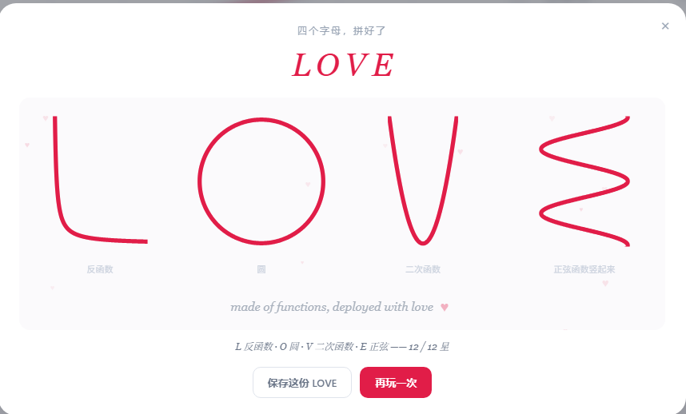

# LOVE · 函数拼字

> 选函数、调参数，用四条函数曲线拼出 **L · O · V · E** 的一个小游戏。
> 纯 HTML/CSS/JavaScript，无框架、无构建、无依赖，双击 `index.html` 就能玩。

在线玩：<https://070712zz.com/love-functions/>
它是「070712 小站」的第一个作品，[回小站首页](https://070712zz.com/)。



## 这是什么

四个关卡，每关给你一个目标字母（灰色虚线和误差带），你要从**函数库**里挑函数、拖动参数滑块，让红色曲线贴住它：

| 关卡 | 字母 | 推荐函数 | 图形是什么 |
| --- | --- | --- | --- |
| 01 | **L** | 反函数 `y = a/(x−h) + v` | 双曲线的一支，两条渐近线正好围出 L 的拐角 |
| 02 | **O** | 圆 `(x−h)² + (y−v)² = r²` | 一个圆就是 O |
| 03 | **V** | 二次函数 `y = a(x−h)² + v` | 收窄的抛物线开口 |
| 04 | **E** | 正弦·竖 `x = A·sin(ω(y−v)) + h` | 把竖起来的正弦反过来，三个朝右的波峰就是三条横臂 |

四关都通过后，会有一段小动画：四个字母被逐笔画出来，小爱心慢慢飘起来，最后浮现一句话
**made of functions, deployed with love** —— 还能一键保存成 PNG 图片。



## 玩法

- 从右侧（手机上是下方）「函数库」点一个函数添加，最多 5 个，可以叠加组合。
- 选中一个函数，拖动它的参数滑块，实时看匹配度变化。
- 匹配度 ≥ **66%** 过关，**82%** 两星，**92%** 三星。
- 卡住了就点「需要提示？」；每关都有对应函数的提示。
- 进度会存在浏览器 `localStorage` 里，关掉页面也不丢。

计分方式是「覆盖率 + 精确率」的 F1：既要盖住目标虚线，也不能乱画到无关的地方，所以画得越准分越高。

## 本地运行

不需要安装任何东西：

- 直接双击这个文件夹里的 `index.html`（用 `file://` 打开也能玩）；
- 或者起一个静态服务器（推荐，模拟线上环境）：

```powershell
# 在仓库根目录（不是这个子文件夹）
python -m http.server 8000
# 然后浏览器打开 http://localhost:8000/love-functions/
```

改完刷新浏览器即可，没有构建步骤。

## 文件结构

```
love-functions/            # 这个作品自己的文件夹（URL：/love-functions/）
├─ index.html              # 页面结构
├─ assets/
│  ├─ style.css            # 样式（简洁风、响应式，颜色变量在顶部）
│  ├─ game.js              # 游戏逻辑：关卡 / 函数库 / 画布 / 存档
│  ├─ scoring.js           # 匹配打分：栅格化 + 倒角距离变换 + F1
│  └─ favicon.svg          # 图标
├─ docs/                   # README 用的截图
├─ tools/
│  └─ check-scoring.js     # 打分算法冒烟测试（Node 运行，非必需）
└─ README.md

# 仓库上一层是「070712 小站」的首页和公共文件：
#   ../index.html   ../assets/   ../CNAME   ../DEPLOY.md   ../LICENSE
```

## 部署

这个小游戏是 **<https://070712zz.com/love-functions/>**，跟着整个小站一起部署在 GitHub Pages 上。
站点结构、自定义域名、DNS 记录、HTTPS 证书的完整步骤见仓库根目录的 **[DEPLOY.md](../DEPLOY.md)**。

日常更新（在仓库根目录）：

```powershell
git add -A
git commit -m "update: 说明改了什么"
git push
```

推送后 1～2 分钟自动上线，浏览器 `Ctrl + F5` 强刷即可。

> 纯静态页面，不需要服务器、数据库或后端。

## 自己改着玩

想换成别的字、别的函数，主要改这几个地方：

- **关卡目标**：`assets/game.js` 里的 `LEVELS`，每关有 `letter / theme / desc / hint / bbox / target`；
  `bbox` 是字母区域（同时决定画布视野和计分范围），`target` 是标准答案函数。
- **函数库**：`assets/game.js` 里的 `TYPES`，新增一个函数只需要写 `name / formula / params / sampleCurve`（采样函数在 `sampleCurve` 里加一个分支）。
- **过关阈值**：`PASS / STAR2 / STAR3` 三个常量。
- **视觉**：`assets/style.css` 顶部的 CSS 变量（主色 `--accent`、背景、圆角、阴影等）。

## 技术说明

- 画布用原生 Canvas 2D，曲线按参数采样成折线再绘制；DPR 自适应，手机上也清晰。
- 打分在 `scoring.js` 里：把目标折线和玩家折线栅格化成 0/1 掩码，用倒角距离变换求每个像素到另一张掩码的距离，再算覆盖率 / 精确率，取 F1。算法不依赖 DOM，`node tools/check-scoring.js` 可以直接跑测试。
- 没有第三方库、没有网络请求、没有字体下载，离线可用。

## 浏览器兼容

现代 Chrome / Edge / Firefox / Safari / 手机浏览器均可（需要 Canvas 2D 与 CSS `aspect-ratio`，2021 年后的浏览器都支持）。

## License

MIT，见 [LICENSE](../LICENSE)。
